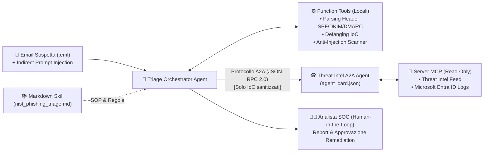

# 🛡️ SecOps Agentic SOC Tier-1: Skills + Function Tools + MCP + A2A


-green.svg)


Un laboratorio pratico di **AI Security Engineering & SOC Automation** che dimostra come progettare un sistema multi-agente per il triage automatico di campagne di **Spearphishing (AiTM)** e la correlazione di log di identità Cloud (**Microsoft Entra ID**), rispettando i principi di **Least Privilege**, **Defense in Depth** e **Zero-Trust**.

---

## 🏗️ Architettura del Sistema



### Perché questo Stack tecnologico?
1. **Skills in Markdown (`skills/nist_phishing_triage.md`)**: Codificano i playbook operativi standard (NIST SP 800-61) in modo leggibile e verificabile dal team di sicurezza, separando la procedura dal codice.
2. **Function Tools (`tools/forensic_tools.py`)**: Eseguono le operazioni forensi critiche (verifica spoofing, estrazione regex di IP/URL, defanging `hxxps://`, calcolo matematico del Risk Score e scansione anti-Prompt Injection) in modo **100% deterministico**, azzerando il rischio di allucinazioni.
3. **Protocollo A2A (`agents/threat_intel_a2a_agent.py` + `agent_card.json`)**: Separa l'agente esposto all'input malevolo (`TriageOrchestrator`) dall'agente che interroga i sistemi interni (`ThreatIntelA2AAgent`), prevenendo movimenti laterali in caso di compromissione del prompt.
4. **Model Context Protocol (`mcp_servers/secops_mcp_server.py`)**: Incapsula l'accesso ai log di **Microsoft Entra ID** e ai feed di Threat Intelligence in un server isolato e strettamente **Read-Only**.

---

## 🚀 Quickstart (Esegui la Demo in 30 secondi)

```bash
git clone [https://github.com/andrebrunii/secops-agentic-soc-tier1.git](https://github.com/andrebrunii/secops-agentic-soc-tier1.git)
cd secops-agentic-soc-tier1
pip install -r requirements.txt
python main.py
pytest -v
```

Consulta il file [`SECURITY.md`](./SECURITY.md) per i dettagli sul Threat Modeling dell'architettura.
